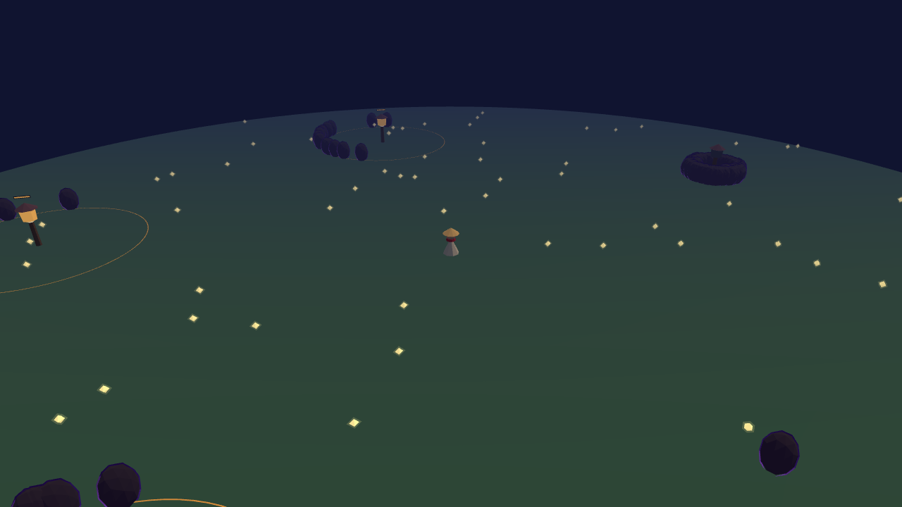

# Đảo Đèn Lồng

Game 3D chạy trên trình duyệt, theo **Phase 4 / Test Contract v1.3**. Mây phải giữ đủ đèn sáng và sống sót đến bình minh trên Đảo Bến, Đảo Cau và Đảo Chuông.



## Cài đặt và chạy

Cần Node.js 22.12 trở lên và trình duyệt hiện đại hỗ trợ WebGL2. Clone repo sạch rồi chạy tối đa ba lệnh:

```sh
npm ci
npm run build
npm run start
```

Mở `http://127.0.0.1:4178`. Dùng `npm run dev` để phát triển. Trên PowerShell, dùng `npm.cmd` nếu `npm.ps1` bị chặn. Bản web nằm ở `dist/client/`, CLI headless ở `dist/headless.js`.

## Điều khiển

- **W/A/S/D** hoặc phím mũi tên: di chuyển; **J**: nhảy; **Shift**: lướt.
- Đom đóm tự nhặt; **E**: châm dầu hoặc thắp đèn gần nhất.
- **F / Space**: Tỏa Sáng; **V**: đổi camera; kéo chuột: xoay camera.
- **P / Esc**: tạm dừng.
- Có thể đổi mọi phím trong **Cài đặt**; phím trùng bị từ chối, có nút khôi phục mặc định.

Mỗi đom đóm nạp vào đèn thêm 10 dầu. Đèn đang sáng hao 1 dầu/giây; đèn yếu dưới 30 dầu mất vùng an toàn và Bóng Mực có thể hút dầu. Đèn từng tắt chỉ cần 5 đom đóm để thắp lại. Sức chứa túi tăng 2 sau mỗi lần thắp thành công, tối đa 20.

## Mục tiêu và điểm

Mây bắt đầu mỗi đêm với ba Ngọn Lửa. Thắng bằng cách sống đến bình minh và giữ sáng ít nhất 60% số đèn: 3/5, 4/6, 5/7. Thời lượng lần lượt là **4:00, 4:30, 5:00**. Hết lửa hoặc không đủ đèn sáng khi hết giờ là thua.

- Nạp mỗi đom đóm: **5 điểm**; thắp lần đầu: **100**; thắp lại: **40**.
- Tỏa Sáng trúng Bóng Mực: **5 điểm**, hoặc **15** nếu Bóng đang hút dầu.
- Thắng bình minh: mỗi đèn đang sáng **50 + floor(dầu)** điểm; mỗi Ngọn Lửa còn lại **50 điểm**.
- Không có thưởng thời gian.

Cài đặt **Bảng màu dễ phân biệt** được lưu trên trình duyệt. Thông số chính thức ở [`game.contract.json`](game.contract.json).

Menu có bảng xếp hạng top 10 lưu cục bộ; sau khi thua hoặc thắng toàn chiến dịch có thể nhập tên 3–12 ký tự chữ/số/gạch dưới. Cài đặt gồm giảm chuyển động, chữ lớn và cảnh báo trực quan cho Bóng Mực, gió, 10 giây cuối và đèn yếu.

## Test và headless

```sh
npm test
npm run build
```

Chạy benchmark 30 giây và soak test 10 đêm, lần lượt ghi bằng chứng JSON:

```sh
npm run bench -- --seed 42 --duration 30 --out docs/proof/phase-4/bench.json
npm run build:headless
npm run soak -- --seed 7 --nights 10 --out docs/proof/phase-4/soak.json
```

Lệnh soak giới hạn V8 old space ở 32 MB và semi-space ở 1 MB, đồng thời gọi GC giữa các đêm; RSS trong báo cáo vẫn là bộ nhớ tiến trình thực đo. Benchmark chạy Chromium ở 1280×720, tắt VSync qua các cờ trình duyệt; `peak_mem_mb` là `null` vì bản web không cung cấp RSS đáng tin cậy của toàn bộ tiến trình Chromium.

Ảnh chuẩn, số đo, lệnh tái tạo và giới hạn phép đo nằm trong [bằng chứng Phase 4](docs/proof/phase-4/README.md); ghi nhận hồi cứu ở [retro Phase 1–4](docs/retro-phase-4.md).

Ví dụ kiểm chứng một lần thắp đèn tại bình minh:

```sh
node dist/headless.js --seed 42 --night 1 --ticks 1 --scenario scenarios/phase-3/win-at-dawn.json --inputs scenarios/interact.inputs.json --snapshot-every 1 --out dawn.jsonl
```

CLI ghi snapshot/event JSONL; dòng cuối là `end`. Xem [ghi chú Phase 3](docs/notes/phase-3.md), [ADR](docs/adr/0003-lantern-fuel-and-dawn-victory.md), [changelog](CHANGELOG.md) và [bằng chứng Phase 3](docs/proof/phase-3/README.md). Bằng chứng [Phase 1](docs/proof/phase-1/README.md) và [Phase 2](docs/proof/phase-2/README.md) là hồ sơ lịch sử của các phiên bản trước.

## Tài liệu

- [Hướng dẫn bổ sung](README_ver2.md) · [Harness agent](AGENTS.md)
- [Giả định Phase 1](docs/notes/phase-1.md) · [đặc tả lịch sử Phase 2](docs/notes/phase-2.md)
- [Hướng dẫn lab](GUIDE.md) · [Checkpoints](CHECKPOINTS.md) · [Nộp bài](SUBMISSION.md)
- [Bằng chứng Phase 4](docs/proof/phase-4/README.md) · [Hướng dẫn gói phát hành](docs/proof/phase-4/release/README.md) · [Retro Phase 1–4](docs/retro-phase-4.md)
- [Quy định](RULES.md) · [Rubric](RUBRIC.md) · [CREDITS](CREDITS.md) · [License](LICENSE)
